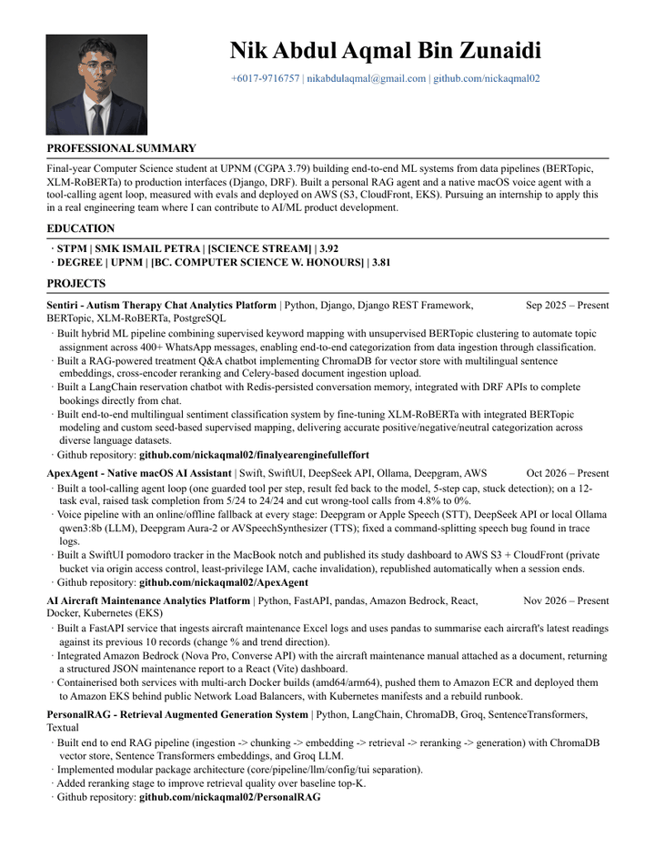

<a href="https://github.com/nickaqmal02">
  <picture>
    <source media="(prefers-color-scheme: dark)" srcset="https://raw.githubusercontent.com/nickaqmal02/nickaqmal02/master/dark_mode.svg">
    
  </picture>
</a>

  

### Final-year Computer Science @ UPNM · applied NLP & ML · backend engineering

I build models that survive evaluation and backends that people actually use.
Email: **nikabdulaqmal@gmail.com** ·
[📄 Résumé (PDF)](https://raw.githubusercontent.com/nickaqmal02/nickaqmal02/master/nik_resume.pdf)

<table align="center">
  <tr>
    <td align="center" width="20%"><b>0.933</b> negative recall</td>
    <td align="center" width="20%"><b>2,000</b> hand-labelled msgs</td>
    <td align="center" width="20%"><b>4</b> models benchmarked</td>
    <td align="center" width="20%"><b>1,400+</b> journal lines</td>
    <td align="center" width="20%"><b>3.79</b> CGPA · Dean's List</td>
  </tr>
</table>

<b>Résumé preview</b> (pages loop every 6s)

 

---

## 📌 Portfolio

### 🧠 Sentiri — Autism therapy chat analyzer
`Python` · `Django 6` · `PyTorch` · `PostgreSQL` · `ChromaDB` · `LangChain` · `Celery`

Clinical platform for autism therapy centres: imports WhatsApp exports, links messages to clients, and turns them into sentiment, topics, and grounded answers.

- **Sentiment** — XLM-RoBERTa fine-tuned on 2,000 self-labelled Malay / code-switched therapy messages.
- **Topics** — BERTopic (UMAP → HDBSCAN → c-TF-IDF) with Sastrawi stemming, resolving to 5 supervisor-confirmed themes across 266 analysed messages.
- **RAG assistant** — multilingual MiniLM → ChromaDB → cross-encoder rerank (retrieve 20, answer from 5) over clinic treatment documents.
- **Booking agent** — LangChain + GLM-5.3 with Redis memory; the LLM proposes, Python verifies availability, only then is it confirmed.
- **Privacy** — a PII wall strips 54 client/therapist name tokens before any text reaches a model.
- **Ops** — Celery Beat reminders, role-based dashboards (admin / therapist / doctor / client), DSM-5 specifier approval workflow.

[**Repository →**](https://github.com/nickaqmal02/finalyearenginefulleffort)

---

### 📊 Model evaluation — XLM-R vs mBERT vs IndoBERT vs DistilBERT
`PyTorch` · `Hugging Face` · `Quarto` · `Jupyter`

My project shipped XLM-R because "it handles Malay natively." That is a hypothesis, so I tested it on the same 432-message held-out split.

| Model | Accuracy | Macro-F1 | Negative recall | Params |
|---|---|---|---|---|
| **mBERT** | **0.882** | **0.881** | 0.919 | 178M |
| **XLM-R** | 0.863 | 0.862 | **0.933** | 278M |
| IndoBERT | 0.509 | 0.046 | 0.899 | 124M |
| DistilBERT | 0.345 | 0.171 | 1.000 | 135M |

- The hypothesis lost: mBERT also won on rojak (**0.951 vs 0.926**) and pure Malay (**0.923 vs 0.863**).
- The decision held anyway: in a therapy context the expensive error is missing distress, so XLM-R's negative recall won the requirement — documented as a trade-off, not hidden.
- Two baselines collapsed and are reported as-is.
- Topic modelling defended architecturally (no labels): 42% multi-topic rate, NPMI c_v coherence −0.753, honestly interpreted for 3-token documents.

[**Repository →**](https://github.com/nickaqmal02/MatrixEvaluationModel)

---

### 🎙 ApexAgent — macOS voice agent in pure Swift
`Swift` · `Ollama` · `Deepgram` · `Accessibility API`

Jarvis, but local. Voice in → intent → tool execution → voice out, with an online *and* offline path at every stage: Deepgram Flux / Apple Speech, GLM API / local Qwen3 8B, Aura-2 / `AVSpeechSynthesizer`. No Xcode project — Swift Package Manager from the terminal.

[**Repository →**](https://github.com/nickaqmal02/ApexAgent) · [**Demo video →**](https://github.com/nickaqmal02/ApexAgent/blob/main/media/simpledemo.mp4)

---

### 🔎 PersonalRAG — a second brain in the terminal
`Python` · `Textual` · `Groq` · vector search

Personal retrieval-augmented agent with a real TUI: ingest PDFs, semantic search, cited answers with source tracking, persistent local embeddings. Where I learned retrieval quality — not prompt wording — decides whether RAG works.

[**Repository →**](https://github.com/nickaqmal02/PersonalRAG)

---

## 🧰 Also on GitHub

| Project | What it is | Stack |
|---|---|---|
| [django_ecommerce_stripe](https://github.com/nickaqmal02/django_ecommerce_stripe) | E-commerce with payments and order state | Django, Stripe |
| [studentperformanceanalysis](https://github.com/nickaqmal02/studentperformanceanalysis) | Exploratory analysis + modelling notebook | Python, pandas |
| [diet-optimizer](https://github.com/nickaqmal02/diet-optimizer) | Constraint-based meal planning | Laravel, Blade |
| [fuzzylogicvisualization](https://github.com/nickaqmal02/fuzzylogicvisualization) | Interactive fuzzy-inference explainer | HTML, JS |
| [DIGITALIMAGEPROCESSING](https://github.com/nickaqmal02/DIGITALIMAGEPROCESSING) | Coursework: filters, transforms, feature work | Python |
| [notesprojectcli](https://github.com/nickaqmal02/notesprojectcli) | CLI notes app | Python |
| [learningdjangoblog](https://github.com/nickaqmal02/learningdjangoblog) · [fullstackapplication](https://github.com/nickaqmal02/fullstackapplication) · [javascriptlearningjourney](https://github.com/nickaqmal02/javascriptlearningjourney) · [first_rust_program](https://github.com/nickaqmal02/first_rust_program) | Learning tracks kept public on purpose | Django · JS · Rust |
| [RAGLearning](https://github.com/nickaqmal02/RAGLearning) · [RAGPersonalAcademy](https://github.com/nickaqmal02/RAGPersonalAcademy) | RAG bootcamp notes and experiments | Python |

---

## 🎓 Education & awards

| | |
|---|---|
| **B.Sc. Computer Science (Honours)** | National Defence University of Malaysia (UPNM) · CGPA **3.79** |
| **STPM** | Science stream · 3.92 |
| **Awards** | Dean's List · First Class Award, UPNM |
| **Certifications** | MATLAB Fundamentals & Machine Learning · Django & REST APIs · Full-stack (Tailwind, JS, PostgreSQL) |
| **Currently learning** | FastAPI + Poetry, vector databases, Swift beyond the terminal |

---

> I'd rather understand a pipeline than copy one. The engineering journal for Sentiri is
> [1,400+ lines of bugs, wrong hypotheses, and the reasoning that fixed them](https://github.com/nickaqmal02/finalyearenginefulleffort/blob/main/progress.md).

<!--
  The card above is generated, not hand-edited:
    make_logo.py   Neovim logo PNG -> ascii_logo.json   (Pillow only)
    build_svg.py   layout -> light_mode.svg + dark_mode.svg
    today.py       live GitHub stats -> SVG text nodes
    .github/workflows/build.yaml -> runs today.py nightly and on push

  Older long-form profile: profile-readme-v1.md
-->
